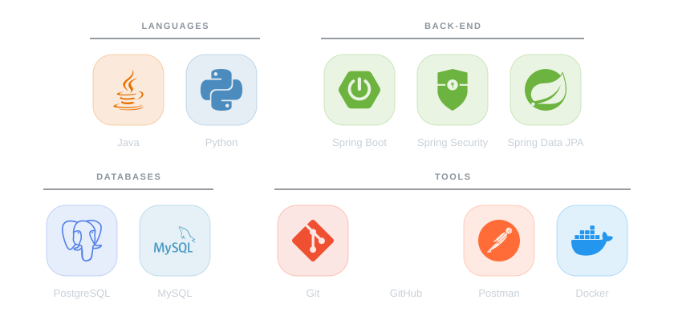

  <i>🌍 Read in: <b>English</b> · <a href="./README.md">Português</a></i>

<h1 align="center">
  
  Hi, I'm Antônio Marcos
</h1>

  

  
  
  
  

  
  

---

## 👨‍💻 About me

I'm a junior developer at a startup that builds systems to solve one specific problem. I work mainly on the back-end with Java and Spring, always aiming for efficient solutions and clean code.

<table>
  <tr>
    <td><b>Role</b></td>
    <td>Junior Back-end Developer</td>
  </tr>
  <tr>
    <td><b>Location</b></td>
    <td>Fortaleza, CE — Brazil</td>
  </tr>
  <tr>
    <td><b>Focus</b></td>
    <td>Back-end with Java and Spring Boot, in the Web ecosystem</td>
  </tr>
  <tr>
    <td><b>Main tools</b></td>
    <td>Spring Security, Spring Data JPA, PostgreSQL and Docker</td>
  </tr>
  <tr>
    <td><b>Contact</b></td>
    <td><a href="mailto:marcos.dev038@gmail.com">marcos.dev038@gmail.com</a></td>
  </tr>
</table>

---

## 💼 Experience

### Junior Developer · Tech startup
`Current`

I build systems that solve one specific business problem, focusing on efficient solutions, clean code and the Web ecosystem.

### Development Intern · School management software company
`Aug 2025 — Dec 2025`

I interned at a company with more than 45 years in the market that works with PHP and serves the school ecosystem. There I built the **extracurricular activities** module:

- Linking **students, teachers and classes** for each activity
- Management of students, teachers and lessons
- **Attendance** tracking for each lesson
- **Log** generation for the operations
- Data sync to the company's **main system** database

---

## 🚀 Stack

  <picture>
    <source media="(prefers-color-scheme: dark)" srcset="./assets/stack-en-dark.svg" />
    <source media="(prefers-color-scheme: light)" srcset="./assets/stack-en-light.svg" />
    
  </picture>

---

## 📊 GitHub activity

  

 

<table align="center">
  <tr>
    <th align="center">Top languages by commit</th>
    <th align="center">Stats</th>
  </tr>
  <tr>
    <td align="center">
      
    </td>
    <td align="center">
      
    </td>
  </tr>
</table>

---

## 📫 Contact

Want to talk back-end, or need a developer for a project? Reach out:

 

