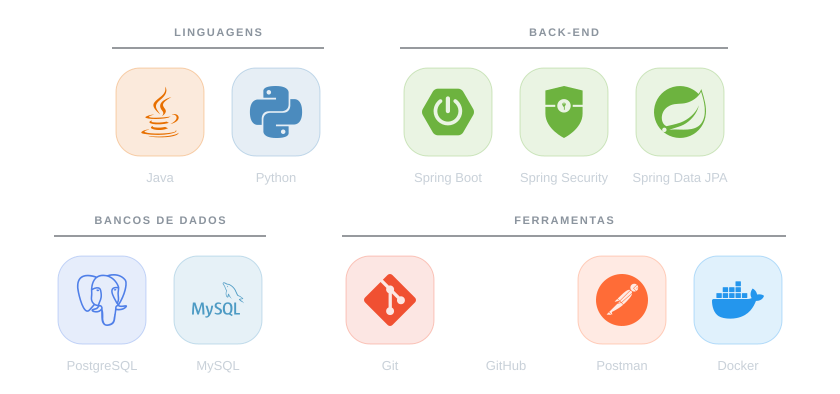

  <i>🌍 Leia em: <b>Português</b> · <a href="./README-EN.md">English</a></i>

<h1 align="center">
  
  Olá, eu sou o Antônio Marcos
</h1>

  

  
  
  
  

  
  

---

## 👨‍💻 Sobre mim

Sou desenvolvedor júnior em uma startup que cria sistemas para resolver um problema específico. Trabalho principalmente com back-end em Java e Spring, sempre buscando soluções eficientes e código limpo.

<table>
  <tr>
    <td><b>Função</b></td>
    <td>Desenvolvedor Back-end Júnior</td>
  </tr>
  <tr>
    <td><b>Localização</b></td>
    <td>Fortaleza, CE — Brasil</td>
  </tr>
  <tr>
    <td><b>Foco</b></td>
    <td>Back-end com Java e Spring Boot, no ecossistema Web</td>
  </tr>
  <tr>
    <td><b>Principais ferramentas</b></td>
    <td>Spring Security, Spring Data JPA, PostgreSQL e Docker</td>
  </tr>
  <tr>
    <td><b>Contato</b></td>
    <td><a href="mailto:marcos.dev038@gmail.com">marcos.dev038@gmail.com</a></td>
  </tr>
</table>

---

## 💼 Experiência

### Dev Júnior · Startup de tecnologia
`Atual`

Desenvolvo sistemas para resolver um problema específico do negócio, com foco em soluções eficientes, código limpo e no ecossistema Web.

### Estágio em Desenvolvimento · Empresa de sistemas para escolas
`Ago/2025 — Dez/2025`

Estagiei em uma empresa com mais de 45 anos de mercado, que trabalha com PHP e atende o ecossistema escolar. Lá desenvolvi o módulo de **atividades extracurriculares**:

- Vínculo entre **alunos, professores e turmas** de cada atividade
- Gestão de alunos, professores e aulas
- Registro de **frequência** nas aulas
- Geração de **logs** das operações
- Envio dos dados para a base do **sistema principal** da empresa

---

## 🚀 Stack

  <picture>
    <source media="(prefers-color-scheme: dark)" srcset="./assets/stack-pt-dark.svg" />
    <source media="(prefers-color-scheme: light)" srcset="./assets/stack-pt-light.svg" />
    
  </picture>

---

## 📊 Atividade no GitHub

  

 

<table align="center">
  <tr>
    <th align="center">Linguagens por commit</th>
    <th align="center">Estatísticas</th>
  </tr>
  <tr>
    <td align="center">
      
    </td>
    <td align="center">
      
    </td>
  </tr>
</table>

---

## 📫 Contato

Quer trocar uma ideia sobre back-end ou precisa de um desenvolvedor para um projeto? Me chame por aqui:

 

